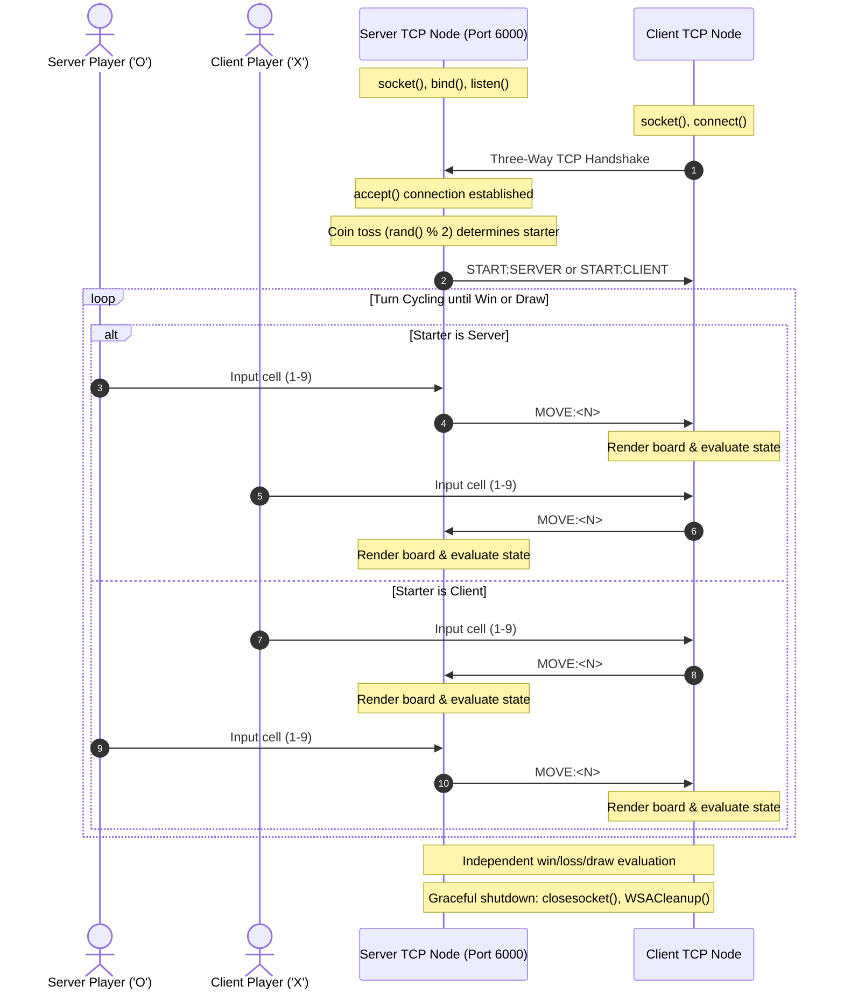

# Client-Server Tic-Tac-Toe in C over TCP Sockets (Winsock2)

[](https://en.wikipedia.org/wiki/C_(programming_language))
[](https://learn.microsoft.com/en-us/windows/win32/winsock/windows-sockets-start-page-2)
[](https://www.mingw-w64.org/)
[](https://ime.eb.mil.br/)
[](index.html)
[](LICENSE)

A network application for a two-player **Tic-Tac-Toe (Jogo da Velha)** game written in C using low-level **TCP Sockets (Winsock2 API)**. Developed as a major evaluation project for the **Computer Networks I** course at the **Military Institute of Engineering (IME)**.

---

## 👥 Authors & Academic Context

* **Pedro Augusto** — Electronics Engineering, IME
* **João Victor Pariz** ([@VPariz](https://github.com/VPariz)) — Electronics Engineering, IME
* **Mateus Roma** — Electronics Engineering, IME

*Course:* Computer Networks for Electronics Engineering I (2026.2)  
*Institution:* Instituto Militar de Engenharia (IME), Rio de Janeiro, Brazil.

---

## 🏗️ Architecture & Protocol Specification

The application follows a synchronized Client-Server model over a reliable TCP transport stream:



### 📡 Application Layer Protocol

| Message Format | Direction | Description |
| :--- | :--- | :--- |
| `START:SERVER\n` | Server $\to$ Client | Informs client that the server won the coin toss and starts playing |
| `START:CLIENT\n` | Server $\to$ Client | Informs client that the client won the coin toss and starts playing |
| `MOVE:<N>\n` | Bidirectional | Encodes the player's move on cell $N \in [1, 9]$ |

---

## ⚡ Key Technical Highlights

1. **Automatic Local IP Detection:**
   * Uses `gethostname()` and `gethostbyname()` on startup to display all active local network IPv4 interfaces in the console. Players on different PCs do not need to run `ipconfig`.
2. **Deterministic Turn Handshake (Coin Toss):**
   * Server seeds the pseudo-random generator with `time(NULL)` and determines whether the server (`'O'`) or client (`'X'`) initiates the match.
3. **Robust Input Sanitization:**
   * Handles empty inputs, multicharacter overflows, letters, and out-of-range keys with standard buffer flushing (`stdin`), enforcing moves exclusively within $N \in \{1, \dots, 9\}$.
4. **Independent Board State Validation:**
   * Both nodes maintain local $3 \times 3$ matrix state representations and evaluate the 8 winning alignments (3 horizontal, 3 vertical, 2 diagonal) and full-board draw conditions independently.
5. **Network Resilience & Graceful Shutdown:**
   * Detects abrupt connection loss (`recv() <= 0`) and releases all socket descriptors via `closesocket()` and `WSACleanup()`.

---

## 📂 Repository Structure

```
jogo-da-velha-sockets-tcp/
├── index.html                   # Interactive HTML slide deck for project defense/presentation
├── servidor_velha.c             # Server source: listener, IP autodiscovery, coin toss & turn loop
├── cliente_velha.c              # Client source: connection, interactive terminal UI & move receiver
├── Makefile                     # Cross-platform Makefile (Windows MinGW & POSIX Linux)
├── docs/
│   ├── RELATORIO_JOGO_DA_VELHA.pdf # Full LaTeX technical report (IME official submission)
│   ├── RELATORIO_JOGO_DA_VELHA.tex # LaTeX report source code
│   ├── RELATORIO.md            # Detailed engineering notes in Markdown
│   └── LEIAME.txt              # Original lab instructions and project manifesto
├── assets/
│   ├── ficha_trabalho_p1.jpeg  # Official assignment sheet photo (Page 1)
│   ├── ficha_trabalho_p2.jpeg  # Official assignment sheet photo (Page 2)
│   ├── screenshot_server.jpeg  # Terminal capture showing server host and IP display
│   └── screenshot_client.jpeg  # Terminal capture showing client match completion
├── .gitignore
├── LICENSE                      # MIT License
└── README.md
```

---

## 🖥️ Interactive HTML Presentation (Slide Deck)

An interactive HTML slide presentation is available in [`index.html`](index.html), also hosted live via [GitHub Pages](https://vpariz.github.io/jogo-da-velha-sockets-tcp/).
It was created specifically for classroom presentations and project defense, containing:
* **TCP Socket Lifecycle:** Interactive timeline of `WSAStartup`, `socket`, `bind`, `listen`, `accept`, `connect`, `send`, `recv`, `closesocket`, `WSACleanup`.
* **Network Byte Order & Endianness:** Detailed breakdown of `sockaddr_in`, `htons`, `htonl`, `inet_ntoa` and `inet_addr`.
* **Automatic Local IP Detection:** Explanation of `gethostname()` / `gethostbyname()` for zero-config lab demos.
* **Application Layer Protocol:** Message semantics (`START:SERVER\n`, `START:CLIENT\n`, `MOVE:<1-9>\n`).
* **Source Code Walkthrough:** Side-by-side interactive tab comparison between Server and Client loops.
* **Defensive I/O Programming:** Detailed explanation of `fgets` vs `scanf`, input trimming, buffer draining, and cell occupancy checks.
* **Slide Features:** Fullscreen mode (<kbd>F</kbd>), keyboard navigation (<kbd>&larr;</kbd>/<kbd>&rarr;</kbd>/<kbd>Space</kbd>), and slide index drawer (<kbd>M</kbd>).

To present: simply open `index.html` in any browser!

---

## 🚀 Building & Running

### 1. Compilation

#### Using GNU Make (Recommended):
```bash
make
```

#### Or using GCC directly:

**On Windows (MinGW):**
```cmd
gcc -Wall -Wextra -O2 servidor_velha.c -o servidor_velha.exe -lws2_32
gcc -Wall -Wextra -O2 cliente_velha.c -o cliente_velha.exe -lws2_32
```

**On Linux / POSIX:**
```bash
gcc -Wall -Wextra -O2 servidor_velha.c -o servidor_velha
gcc -Wall -Wextra -O2 cliente_velha.c -o cliente_velha
```

### 2. Execution

#### Scenario A: Local Testing (Same Computer / Loopback)
```cmd
# Terminal 1:
.\servidor_velha.exe

# Terminal 2:
.\cliente_velha.exe
# Press Enter to connect to default 127.0.0.1
```

#### Scenario B: Two Distinct Machines on Local Network (LAN / Wi-Fi)
1. On the **Server Machine**, run `.\servidor_velha.exe`. Note the printed IP (e.g., `192.168.1.150`).
2. On the **Client Machine**, run `.\cliente_velha.exe 192.168.1.150` (or enter the IP when prompted).

---

## 📑 Technical Documentation
For the complete mathematical formulation, network architecture analysis, and grading rubric details, inspect [`docs/RELATORIO_JOGO_DA_VELHA.pdf`](docs/RELATORIO_JOGO_DA_VELHA.pdf).

---

## 📜 License
This project is licensed under the **MIT License** — see the [LICENSE](LICENSE) file for details.
